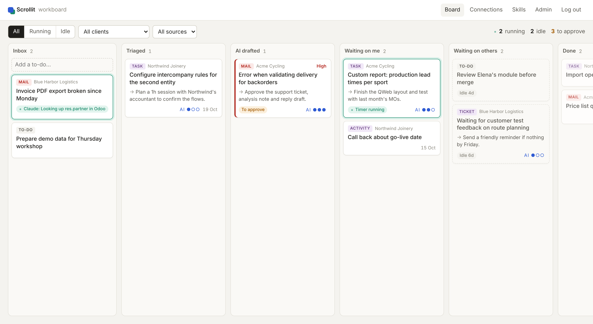

# Workboard

A local, single-user work dashboard. One kanban board over your Odoo tasks, tickets and activities, your Gmail inbox and your own to-dos. Claude triages every card, rates how much it can help, proposes the next step, and drafts actions. Nothing touches Odoo or Gmail until you approve it.

First built for Scrollit. Everything company-specific (Odoo URL, support team, skills repo, names) is configured in `.env`, so it works for any company that uses Odoo 19+ and Google Workspace.



## What it does

- **One board, six columns**: Inbox → Triaged → AI drafted → Waiting on me → Waiting on others → Done. Drag cards between columns (SortableJS + HTMX).
- **Running vs idle at a glance.** A card is *running* while Claude works on it (the badge shows the live step, e.g. "Looking up res.partner in Odoo") or while an Odoo timer runs on its task or ticket. A card is *idle* after `IDLE_AFTER_DAYS` without activity: dashed, muted, "Idle 6d". The toolbar has a Running/Idle filter and live counters.
- **Claude triage** for every new or changed card: classification, customer, urgency, AI-assist score (0–3), next step, and proposed actions. Claude can only *read* (Odoo lookups on an allowlist of models, team skills). It cannot write.
- **Approve, edit or reject actions** in the card drawer: create a helpdesk ticket, post an internal note on it, create a Gmail reply draft, or create a to-do. Payloads are editable JSON before you approve.
- **Misrouted support mail flow**: a customer mails you instead of support → Claude proposes a ticket for the customer's partner (assigned to `ODOO_SUPPORT_TEAM_ID`), an internal note with its analysis and a proposed fix for a colleague, and a reply draft that quotes the new ticket number.
- **Team skills**: clones your skills repo (e.g. `scrollit/claude-skills`, Claude Code plugin marketplace layout), indexes every `SKILL.md`, and lets Claude load the relevant one during triage. Usage is counted per skill.

## Quick start

Linux, macOS or WSL. Needs Python 3.12+, Docker (for Postgres) and `make`.

```bash
make install                 # venv + dependencies
cp .env.example .env         # then fill it in (see below)
make up                      # Postgres in Docker
make migrate
make seed                    # optional: demo cards, creates admin/admin if there are no users
make superuser               # or create your own login
make run                     # http://localhost:8000
make worker                  # second terminal: sync every 5 min, Claude runs, housekeeping
```

`make seed` gives you a board to explore without any credentials. `make sync` runs Odoo, Gmail and skills sync once in the foreground, which is handy the first time.

## Configuration

| What | How |
|---|---|
| **Odoo** (19+, JSON-2 API) | In Odoo: *Preferences → Account Security → New API Key*. Set `ODOO_URL`, `ODOO_DB`, `ODOO_API_KEY`, `ODOO_LOGIN`. The key acts as your user. |
| **Support team** | `ODOO_SUPPORT_TEAM_ID` = the `helpdesk.team` id that misrouted mails should go to. |
| **Gmail** | Google Cloud console → enable Gmail API → OAuth client of type *Desktop app* → save the JSON as `secrets/gmail_client.json` → `make gmail-auth`. Scopes: read and compose drafts. It never sends. |
| **Claude** | `ANTHROPIC_API_KEY`, optionally `CLAUDE_MODEL` (default `claude-sonnet-5-5`). Use your company's org account. Card content (mails, tickets) is sent to the API. |
| **Skills repo** | `SKILLS_REPO_URL` (needs git credentials that can read it), `SKILLS_REPO_PATH`. Pulled fast-forward only every 30 min. Local edits block the pull and are reported, never overwritten. |
| **Behaviour** | `IDLE_AFTER_DAYS` (3), `AGENT_RUN_TIMEOUT_MIN` (15), `AUTO_TRIAGE` (true), `GMAIL_QUERY`. |

## Safety model

1. Claude's tools are read-only: `odoo_search_read` on an allowlist of models (max 20 rows), `read_skill`, `submit_triage`.
2. Claude's output is a *proposal*: rows in `ProposedAction`. Payloads are validated server-side.
3. Only an explicit **Approve** executes an action, in dependency order. Execution is idempotent.
4. Gmail actions create drafts only.

## How it's built

Django 5.2 · PostgreSQL · HTMX 2 · SortableJS · Procrastinate (Postgres-backed jobs, no Redis) · Anthropic Python SDK.

| App | Holds |
|---|---|
| `connector` | `Connection`, Odoo JSON-2 client, Gmail client, sync services and periodic tasks |
| `card` | `Client`, `Card`, board services (activity state, moving, upsert), board views |
| `agent` | `AgentRun`, `ProposedAction`, Claude triage loop, action validation and execution |
| `skill` | `SkillRepo`, `Skill`, clone/pull/index |

Business rules and the data model are in [`docs/analysis/workboard.md`](docs/analysis/workboard.md), including what v1 does differently from the analysis and what still needs checking against a real Odoo.

```bash
make test    # pytest: one test per business rule + smoke tests per URL
make lint    # ruff
```

## Roadmap

- **Phase 2**: retro when a card moves to Done → proposed skill changes → a branch and pull request on the shared skills repo, never a direct push.
- **Phase 3**: local files / Drive, reminders on to-dos, more action types, auto-approve rules.
